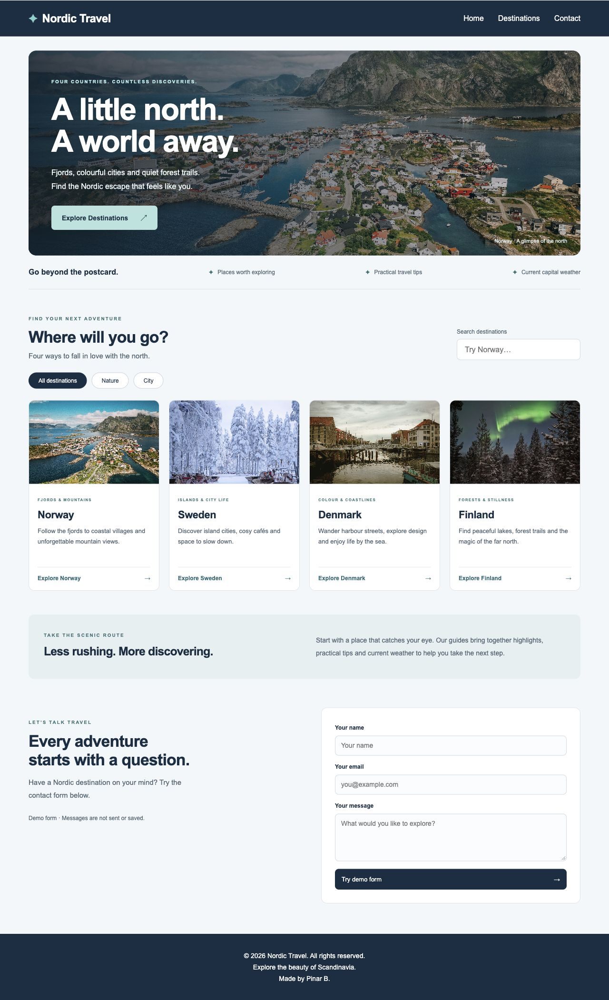
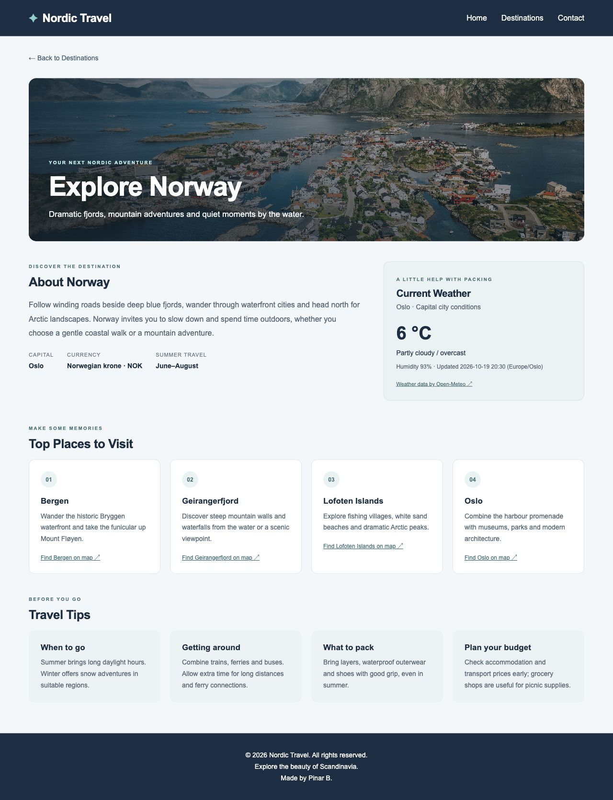

# Nordic Travel

A responsive travel website for exploring **Norway, Sweden, Denmark and Finland**, built with HTML, CSS and vanilla JavaScript.

This learning and portfolio project brings together Nordic destination guides, practical travel tips and current capital-city weather in a consistent, navy-and-teal design.

## Preview

### Home page



### Destination guide



Screenshots show the redesigned interface. Weather values in screenshots are a snapshot from the time of capture, not current conditions.

## Features

- Responsive home page with scenic imagery and country cards.
- Country search combined with Nature and City category filters.
- One dynamic destination page for all four countries.
- Country-specific overview, capital, currency and summer travel information.
- Four places to visit, with OpenStreetMap search links, and four travel tips per country.
- Current weather for each capital from [Open-Meteo](https://open-meteo.com/), with a data timestamp, loading state, error handling and retry button.
- Keyboard focus indicators, labelled inputs, accessible filter states and reduced-motion support.
- A clearly labelled demo contact form with local feedback.

## Run locally

Clone the repository and open its folder:

```sh
git clone https://github.com/Pinar1987/Nordic-Travel.git
cd Nordic-Travel
```

**VS Code:** open `index.html` with the Live Server extension using **Go Live**.

**Or use Python 3:**

```sh
python3 -m http.server 8000
```

Then open [localhost:8000](http://localhost:8000).

No build step, package installation or API key is needed. Internet access is required for weather requests and external map links.

## Destination routes

```text
destination.html?country=norway
destination.html?country=sweden
destination.html?country=denmark
destination.html?country=finland
```

Missing or unsupported country values show a destination-not-found message with a link back to the country list.

## Project structure

```text
index.html         Home page, search, filters and demo contact form
destination.html   Shared destination-page structure
style.css          Shared styles and responsive layouts
script.js          Home-page filtering and demo form feedback
destination.js     Country content and Open-Meteo integration
images/            Existing destination photographs
docs/              Preview screenshots
```

## Weather and contact form

Weather represents the selected country's **capital**, rather than the whole country. The page displays data returned by Open-Meteo; it does not substitute sample values when a request fails. Weather observations can be delayed; check the displayed timestamp.

The contact form is a frontend demonstration. It does **not** send email, save messages or connect to a backend. A delivery service would need to be added for real submissions.

## Validation

- Desktop layout at 1280 px and mobile layout at 375 px checked without horizontal overflow.
- All four destination pages and the invalid-country state checked.
- Combined search/category filtering and empty results checked.
- A real Open-Meteo response verified for Oslo.
- Weather handling checked for network failure, HTTP errors, incomplete data and zero values.
- JavaScript syntax and Git whitespace checks passed.

## Credits

Created by **Pinar B.**

- Weather data: [Open-Meteo](https://open-meteo.com/).
- Place links: [OpenStreetMap](https://www.openstreetmap.org/).
- Photos: reused from the repository's existing `images/` folder. Original photographer and licence information has not yet been documented; inclusion here does not grant reuse rights.
